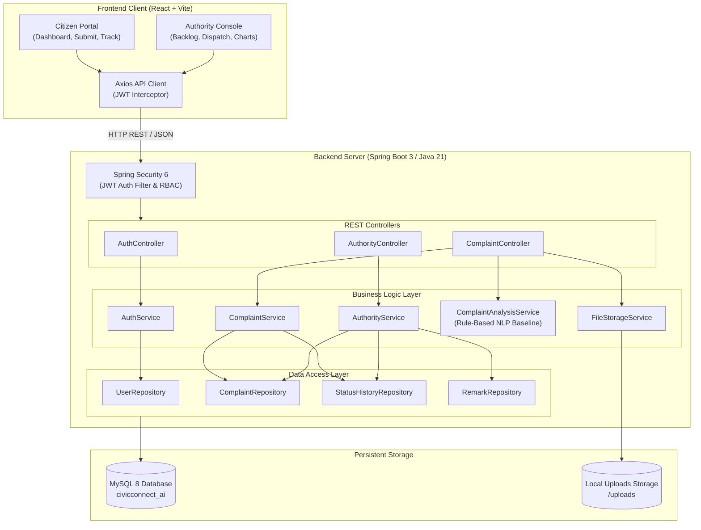
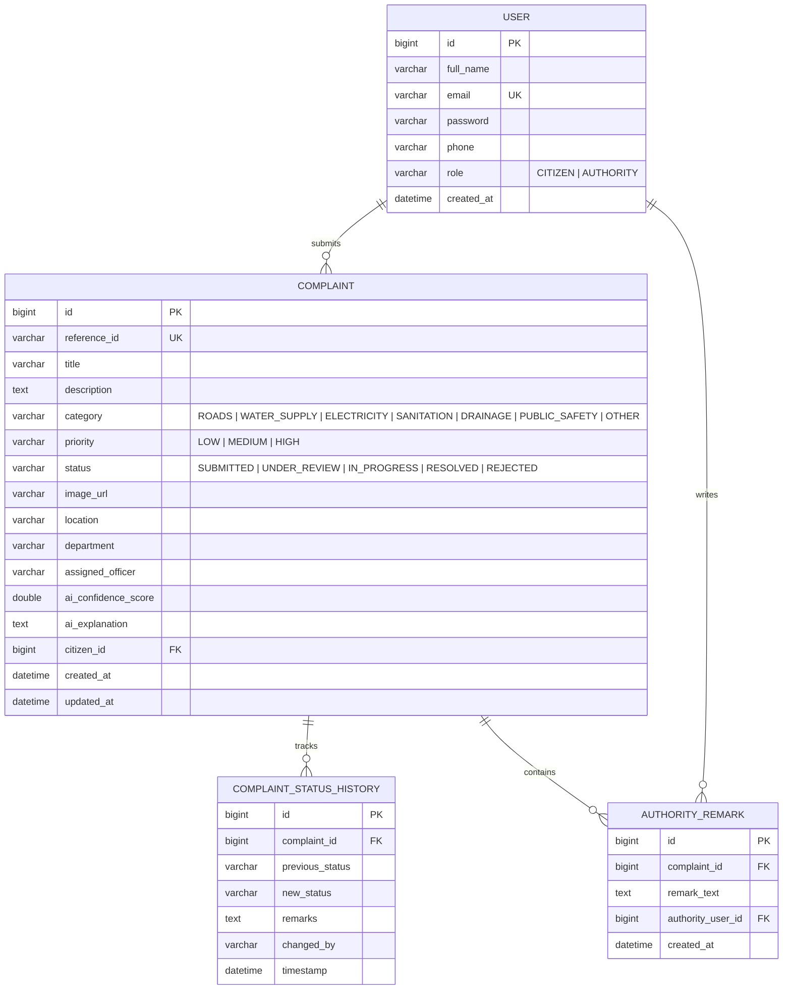

# CivicConnect AI &ndash; AI-Powered Civic Complaint Management System

**CivicConnect AI** is a full-stack civic technology web portal designed to connect citizens directly with municipal and local government authorities. The system enables citizens to report public infrastructure grievances (such as potholes, water leakages, streetlight failures, and garbage accumulation) with descriptions and photo evidence.

The application features an intelligent **AI Complaint Analysis Service** that predicts the municipal department category and assesses urgency priority in real time, routing grievances to an authorized **Municipal Authority Console** for department assignment, status updates, and transparent tracking.

---

## 1. Key Features

* **Citizen Portal:**
  * Clean, responsive landing page with civic service branding.
  * Secure registration and login with BCrypt password hashing and JWT.
  * Real-time dashboard with metrics (Total, Pending, In Progress, Resolved).
  * Complaint submission with photo evidence upload and instant image preview.
  * **Interactive AI Triage Preview:** Real-time preview of AI-suggested category, priority, confidence score, and explanation prior to final submission.
  * Search, category/status/priority filters, and pagination.
  * Live status tracker showing chronological audit trail and official municipal notes.

* **Municipal Authority Console:**
  * Protected console restricted strictly to `AUTHORITY` accounts.
  * Real-time statistical KPI cards and distribution charts (Complaints by Category and Status).
  * Backlog management table with multi-parameter filtering and search.
  * Department & field officer dispatch management.
  * Review and adjust AI-predicted classifications when justified.
  * Enforced state machine workflow: `SUBMITTED` &rarr; `UNDER_REVIEW` &rarr; `IN_PROGRESS` &rarr; `RESOLVED`, or `REJECTED` (with mandatory explanation note).
  * Post official authority remarks to the citizen-facing audit trail.

* **Modular AI Complaint Analysis Service:**
  * Decoupled interface (`ComplaintAnalysisService`) with a transparent, rule-based baseline NLP classifier.
  * Analyzes complaint text for civic domains: `ROADS`, `WATER_SUPPLY`, `ELECTRICITY`, `SANITATION`, `DRAINAGE`, `PUBLIC_SAFETY`, `OTHER`.
  * Computes urgency priority (`HIGH`, `MEDIUM`, `LOW`) based on public hazard indicators.
  * Fully transparent: produces confidence scores and human-readable classification explanations.
  * Pluggable design allows seamless future integration with trained machine learning or LLM models without altering business logic.

---

## 2. Technology Stack

* **Frontend:**
  * React 18 with Vite
  * JavaScript (ES6+), HTML5, and CSS3
  * Responsive layout with modern blue-and-white civic portal theme
  * Axios for REST API communication
  * React Router v6 for role-guarded route navigation
  * Lucide Icons for accessible civic UI indicators

* **Backend:**
  * Java 21
  * Spring Boot 3.3.4
  * Spring Security 6 (Stateless JWT token authentication)
  * Spring Data JPA & Hibernate
  * Bean Validation (`jakarta.validation`)
  * BCrypt password encryption
  * Apache Maven 3.9+

* **Database & Storage:**
  * MySQL 8 (`civicconnect_ai`)
  * Relational schema with foreign keys, indexes, and audit logging
  * Multipart image upload with server-side validation and sanitized storage

---

## 3. Architecture Diagram



---

## 4. Database Relationship Diagram



---

## 5. Quick Start & Execution Guide

### Prerequisites
* **Java 21 JDK** installed
* **Node.js** (v18+) and **npm** installed
* **MySQL 8** running locally (or use the test profile)

### Step 1: Set Up MySQL Database
Create the database in MySQL:
```powershell
& "C:\Program Files\MySQL\MySQL Server 8.0\bin\mysql.exe" -u root -p -e "CREATE DATABASE IF NOT EXISTS civicconnect_ai CHARACTER SET utf8mb4 COLLATE utf8mb4_unicode_ci;"
```

### Step 2: Run the Spring Boot Backend
From the root workspace directory, navigate to `backend/` and start the server:

```powershell
# Set your MySQL root password:
$env:SPRING_DATASOURCE_USERNAME = "root"
$env:SPRING_DATASOURCE_PASSWORD = "your_mysql_password"

# Run with Maven:
& "C:\Users\Shalini\.m2\apache-maven-3.9.6\bin\mvn.cmd" spring-boot:run
```
The backend will launch at `http://localhost:8080`.

*(Note: In automated testing and fallback mode, an in-memory MySQL-compatible H2 database profile is also available via `-Dspring.profiles.active=test`).*

### Step 3: Run the React Frontend
In a second terminal window, navigate to `frontend/` and start the Vite dev server:

```powershell
cd frontend
npm run dev
```
Open `http://localhost:5173` in your browser.

---

## 6. Pre-Configured Demo Credentials

The application includes an automated seeder that preloads accounts for immediate evaluation:

| Portal | Email | Password | Role |
|---|---|---|---|
| **Citizen Portal** | `citizen@example.com` | `Citizen@123` | CITIZEN |
| **Citizen Portal 2** | `anita@example.com` | `Citizen@123` | CITIZEN |
| **Authority Console** | `admin@civicconnect.gov` | `Admin@123` | AUTHORITY |

*(Tip: Both login forms feature instant **"Fill Citizen"** and **"Fill Authority"** quick-fill buttons for rapid testing).*

---

## 7. End-to-End Demonstration Walkthrough

1. **Sign In as Citizen:**
   * Open `http://localhost:5173/login`.
   * Click **"Fill Citizen"** and sign in.
2. **File a New Grievance with AI Triage:**
   * Click **"File Complaint"**.
   * Enter Title: `Dangerous deep crater pothole near Metro Station`.
   * Enter Description: `Large road crater causing two-wheelers to slip during peak traffic. High risk of accident.`
   * Enter Location: `Outer Ring Road, Ward 12`.
   * Click **"Analyze Text with AI"**:
     * Observe predicted category: `ROADS`.
     * Observe predicted priority: `HIGH`.
     * Observe confidence score (e.g., `94%`) and explanation.
   * Attach an evidence photo (optional) and click **"Submit Complaint"**.
   * You will receive a unique reference code (e.g. `CC-2026-F1A9`).
3. **Switch to Authority Console:**
   * Sign out and sign in with **"Fill Authority"** (`admin@civicconnect.gov`).
   * Navigate to `http://localhost:5173/authority`.
   * Inspect the real-time KPI metrics and distribution charts.
   * Locate the newly submitted complaint in the management backlog and click **"Review & Action"**.
4. **Authority Triage & Action:**
   * Assign Department: `Public Works Department (Roads)` and Officer: `D. Kulkarni`. Click **"Save Assignment"**.
   * Advance Status: Choose `UNDER_REVIEW` and enter review notes. Click **"Confirm Status Transition"**.
   * Advance Status: Choose `IN_PROGRESS` and note: *"Road repair team dispatched"*.
   * Post Official Remark: *"Asphalt patching in progress"*.
   * Finally, mark status as `RESOLVED`.
5. **Verify Resolution on Citizen Tracking:**
   * Return to the citizen dashboard or use the public tracking bar on the homepage with your reference ID.
   * Verify the visual timeline stepper has turned green (`RESOLVED`), with full chronological audit logs, timestamps, and officer remarks visible.

---

## 8. Fresher Software Development Interview Defense Guide

When discussing this project during technical interviews, emphasize the following architectural decisions:

1. **Security & Authentication Design:**
   * Built stateless JWT authentication using Spring Security 6.
   * Implemented custom `UserPrincipal` and `JwtAuthenticationFilter` attached to the `OncePerRequestFilter` chain.
   * Password security is enforced via BCrypt salting and hashing.
   * Enforced strict Role-Based Access Control (RBAC): public user registration cannot elevate privileges to `AUTHORITY`.

2. **State Machine & Data Integrity:**
   * Used a deterministic state transition map (`VALID_TRANSITIONS`) in `AuthorityService` to prevent illegal lifecycle jumps (e.g. going from `SUBMITTED` directly to `RESOLVED`).
   * Mandated that rejection requires non-blank justification remarks.
   * Maintained non-repudiation and auditability by logging every transition into `ComplaintStatusHistory`.

3. **Modular AI Engine:**
   * Decoupled classification logic behind the `ComplaintAnalysisService` interface.
   * The initial version implements an explainable rule-based keyword/pattern NLP classifier with severity scoring and confidence calculations.
   * Because the controller and service depend on the interface rather than the concrete class, a machine learning model or LLM API can be dropped in with zero refactoring.

4. **REST API Best Practices:**
   * Strict separation of persistence entities from API contracts using DTOs (`ComplaintResponse`, `ComplaintDetailResponse`, `AuthResponse`) to prevent circular JSON serialization and avoid leaking database structure.
   * Centralized exception handling via `@RestControllerAdvice` returning standard RFC-compliant HTTP status codes (400, 401, 403, 404, 413, 500).
